<div align="center">

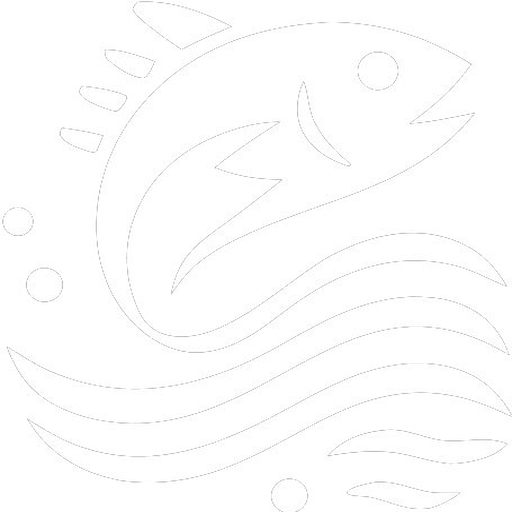

# 🎣 Pesque & Fale

**A rede social dos pescadores: descubra pesqueiros, acompanhe torneios e compartilhe suas pescarias.**


🌐 **[Acessar a plataforma → pesqueefaledb.web.app](https://pesqueefaledb.web.app/)**

</div>

---

## 📑 Sumário

1. [Sobre o projeto](#-sobre-o-projeto)
2. [O que o 4º semestre acrescentou](#-o-que-o-4º-semestre-acrescentou)
3. [Telas da plataforma](#-telas-da-plataforma)
4. [Funcionalidades](#️-funcionalidades)
5. [Arquitetura](#️-arquitetura)
6. [Tecnologias](#️-tecnologias)
7. [Estrutura de pastas](#-estrutura-de-pastas)
8. [Como rodar o projeto](#-como-rodar-o-projeto)
9. [API REST](#-api-rest)
10. [SEO e Analytics](#-seo-e-analytics)
11. [Design](#-design)
12. [Equipe](#-equipe)
13. [Status e próximos passos](#-status-e-próximos-passos)
14. [Licença](#-licença)

---

## 🌊 Sobre o projeto

O **Pesque & Fale** é uma plataforma web inspirada em redes sociais, criada para conectar pescadores e facilitar o compartilhamento de experiências, avaliações e recomendações de locais de pesca.

### ❗ O problema

Encontrar bons locais para pescar nem sempre é fácil. As informações estão espalhadas, nem sempre são confiáveis e raramente são pensadas tanto para o iniciante quanto para o pescador experiente.

### 💡 A solução

Um único lugar onde o pescador pode:

- ⭐ **Avaliar** pesqueiros e ver a nota dada por outros usuários
- 📸 **Publicar** suas pescarias com foto e descrição
- 💬 **Conversar** com outros pescadores pelo chat
- 📍 **Descobrir** novos pontos e torneios na região

### 🎯 Objetivos

| | Objetivo |
|---|---|
| 🎣 | Conectar pescadores |
| 📍 | Ajudar na descoberta de novos pontos de pesca |
| ⭐ | Permitir avaliações de locais |
| 💬 | Incentivar o compartilhamento de experiências |
| 🌱 | Promover o lazer, o trabalho decente e a pesca sustentável |

---

## 🆕 O que o 4º semestre acrescentou

O projeto foi construído a partir da base desenvolvida no 3º semestre. Nesta fase, o foco foi tirar o catálogo de dentro do código do front e dar ao sistema uma infraestrutura de verdade.

| Entrega | Descrição |
|---|---|
| 🔌 **API REST própria** | Node.js + Express + MySQL servindo o catálogo público de eventos e pesqueiros |
| 🔐 **Autenticação da API** | Login com JWT e permissão por perfil (`admin` e `editor`) |
| 🐳 **Containerização** | Banco, API e front sobem juntos com Docker Compose |
| 🌐 **Nginx** | Servidor de estáticos e proxy reverso, com gzip e cache |
| 🔎 **SEO** | Meta tags por rota, Open Graph, JSON-LD, `robots.txt` e sitemap dinâmico |
| 📊 **Google Analytics 4** | `page_view` a cada troca de rota e eventos nomeados |
| 🚫 **Página 404** | Tela própria para rotas não encontradas |

> O Firebase continua responsável por autenticação dos usuários, publicações, chat, notificações e perfis. A API cuida apenas do **catálogo público**, que antes estava escrito à mão dentro do `Home.jsx`.

---

## 📸 Telas da plataforma

### 🏁 Apresentação e acesso

<table>
  <tr>
    <td align="center" width="50%">
      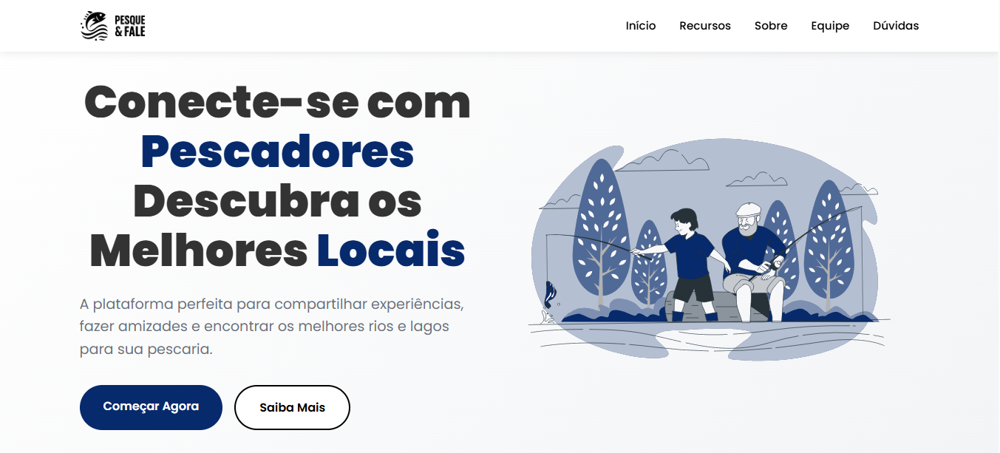<br />
      <sub><b>Página inicial</b> — apresentação da plataforma para quem ainda não tem conta</sub>
    </td>
    <td align="center" width="50%">
      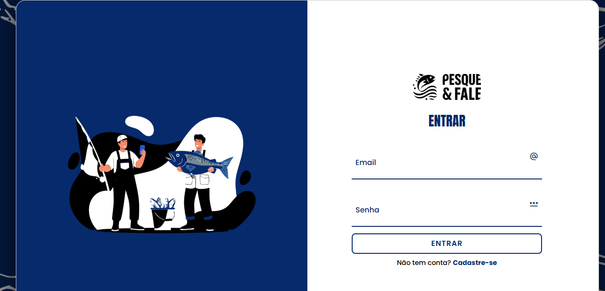<br />
      <sub><b>Login / Cadastro</b> — acesso com e-mail e senha pelo Firebase</sub>
    </td>
  </tr>
</table>

### 👤 Perfil e tema

<table>
  <tr>
    <td align="center" width="50%">
      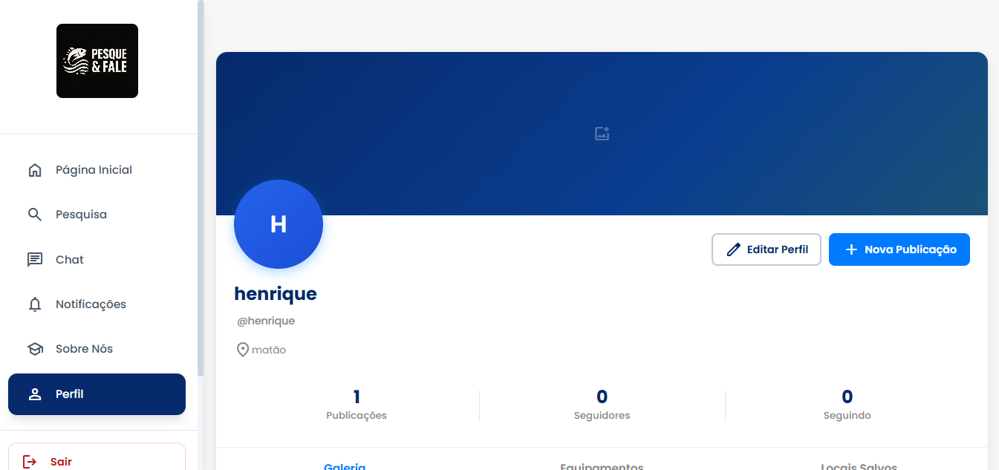<br />
      <sub><b>Perfil</b> — publicações, seguidores, seguindo e abas de galeria, equipamentos e locais salvos</sub>
    </td>
    <td align="center" width="50%">
      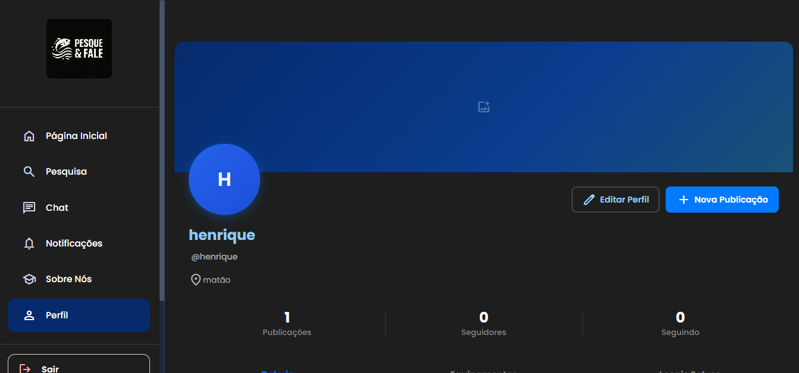<br />
      <sub><b>Modo escuro</b> — o mesmo perfil com o tema alternativo, salvo no navegador</sub>
    </td>
  </tr>
</table>

### 💬 Comunicação

<table>
  <tr>
    <td align="center" width="50%">
      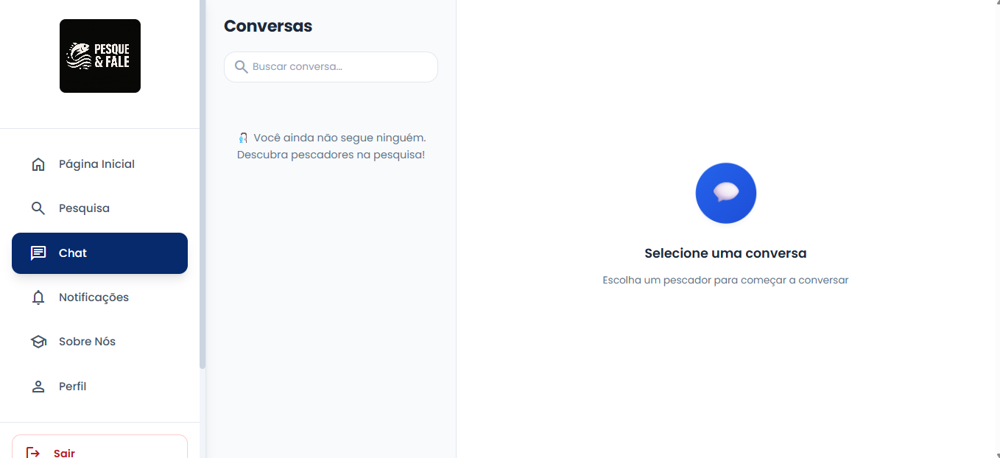<br />
      <sub><b>Chat</b> — lista de conversas com busca e mensagens em tempo real</sub>
    </td>
    <td align="center" width="50%">
      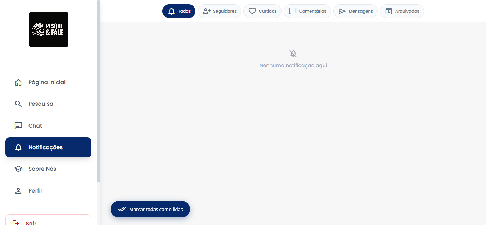<br />
      <sub><b>Notificações</b> — filtros por seguidores, curtidas, comentários, mensagens e arquivadas</sub>
    </td>
  </tr>
</table>

### 🧭 Tour guiado

Na primeira vez que entra na plataforma, o usuário recebe um tour de 9 passos que destaca cada item do menu e explica para que ele serve. O tour pode ser pulado e reiniciado a qualquer momento pelo menu lateral.

<p align="center">
  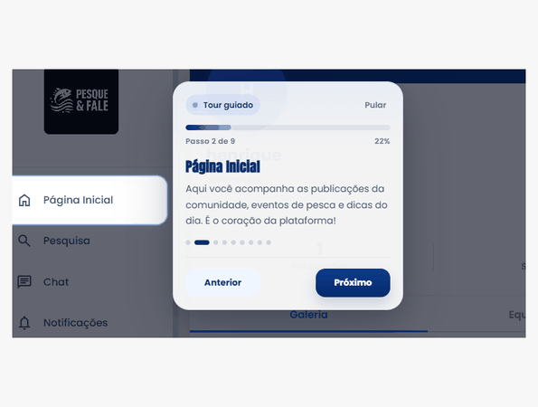
</p>

### ✨ Detalhes da interface

<p align="center">
  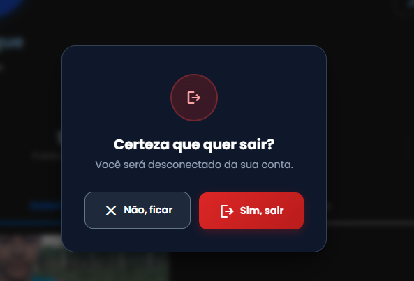<br />
  <sub><b>Confirmação de saída</b> — ações importantes pedem confirmação antes de acontecer</sub>
</p>

### 📱 Versão mobile

No celular, o menu lateral dá lugar a uma barra de navegação inferior, e os botões se adaptam ao espaço disponível.

<table>
  <tr>
    <td align="center" width="50%">
      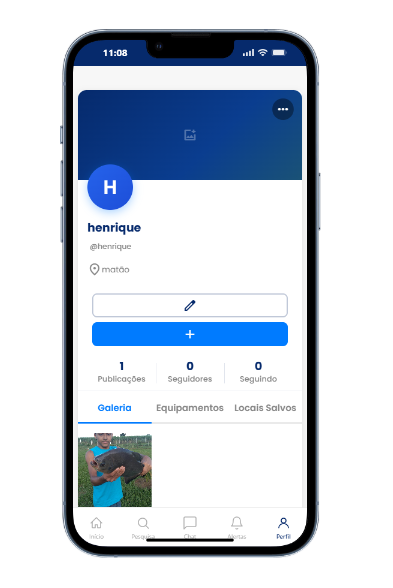<br />
      <sub><b>Perfil</b> — galeria de publicações e barra inferior</sub>
    </td>
    <td align="center" width="50%">
      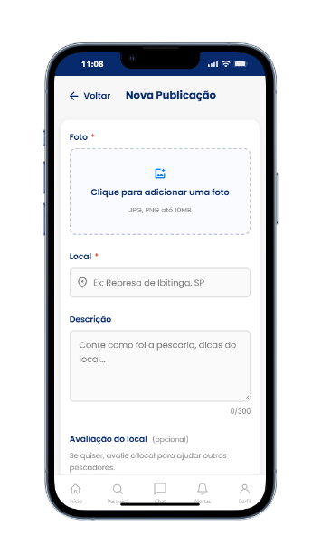<br />
      <sub><b>Nova publicação</b> — foto, local, descrição e avaliação do pesqueiro</sub>
    </td>
  </tr>
</table>

---

## ⚙️ Funcionalidades

### 🔹 Principais

| Funcionalidade | Descrição | Onde fica |
|---|---|---|
| 🔐 Cadastro e login | Conta com e-mail e senha pelo Firebase Authentication | `/login` |
| 🧭 Onboarding | Primeiro acesso guiado, com escolha de username único | `/onboarding` |
| 📰 Feed | Publicações dos pescadores, eventos e pesqueiros em destaque | `/home` |
| 🔎 Pesquisa | Busca de locais de pesca e de outros usuários | `/pesquisar` |
| ⭐ Avaliação de pontos | Nota média e número de avaliações por pesqueiro | `/home`, `/pesquisar` |
| 📸 Publicações | Foto + relato, com curtidas e comentários | `/publicar`, `/post/:userId/:postId` |
| 👤 Perfil | Foto, banner, bio, galeria, seguidores e seguindo | `/perfil`, `/perfil/:id` |
| 💬 Chat | Mensagens em tempo real entre usuários | `/chat`, `/chat/:chatId` |
| 🔔 Notificações | Avisos de curtida, comentário, mensagem e novo seguidor, com contador de não lidas | `/notificacao` |

### 🔹 Extras

- 🌙 **Modo escuro**, com a preferência salva no navegador
- 📱 **Responsividade** completa, com barra de navegação inferior no celular
- 🗺️ **Tour guiado** pela interface para novos usuários
- 📲 **Instalável** como app (PWA via `manifest.json`)

> ℹ️ O **RF 03** (recomendações baseadas em localização) não foi implementado nesta fase do projeto.

---

## 🏗️ Arquitetura

O sistema é dividido em duas frentes que convivem no mesmo front-end:

- **Firebase** cuida de tudo que é **social e pessoal**: contas, perfis, publicações, chat e notificações. Ele oferece atualização em tempo real sem precisar de servidor próprio.
- **API própria (Node + MySQL)** cuida do **catálogo público** de eventos e pesqueiros. É um conteúdo estruturado, relacional e que precisa ser lido por qualquer pessoa — inclusive pelo Google.

### 🧩 Visão geral

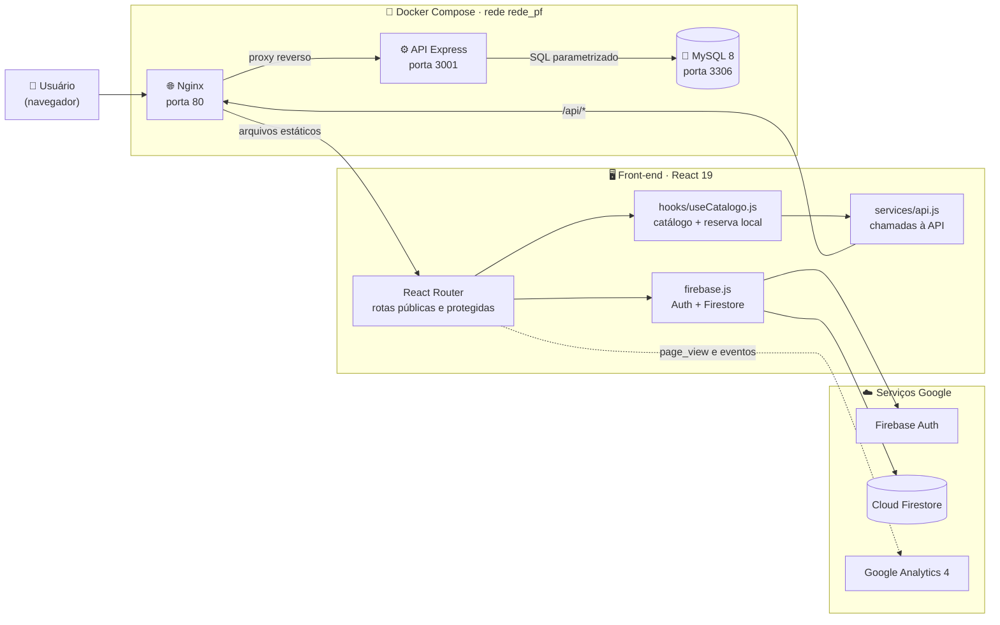

### 🔄 Como o catálogo chega à Home

A Home nunca fica vazia: ela já começa com um **conteúdo de reserva** (`src/data/catalogoReserva.js`) e troca pelos dados reais assim que a API responde. Se a API estiver fora do ar ou demorar mais de 8 segundos, o usuário continua vendo a reserva.

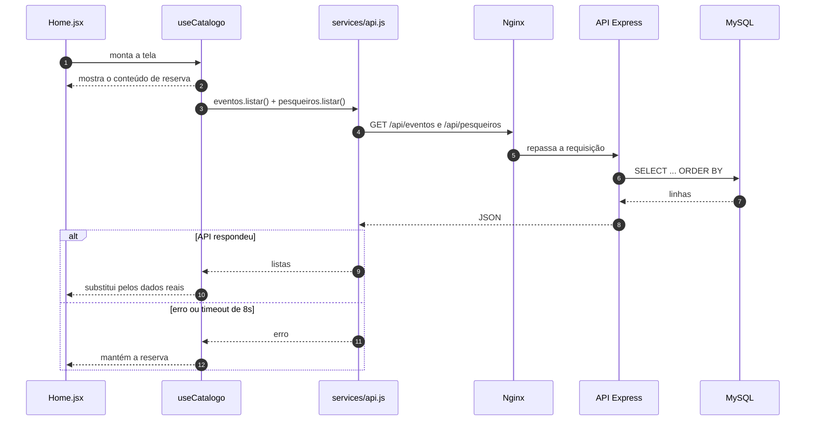

### 🔐 Autenticação e permissões da API

A leitura do catálogo é aberta. Para escrever, é preciso um token JWT, que vale **8 horas**. Apagar registros é exclusivo do perfil `admin`.

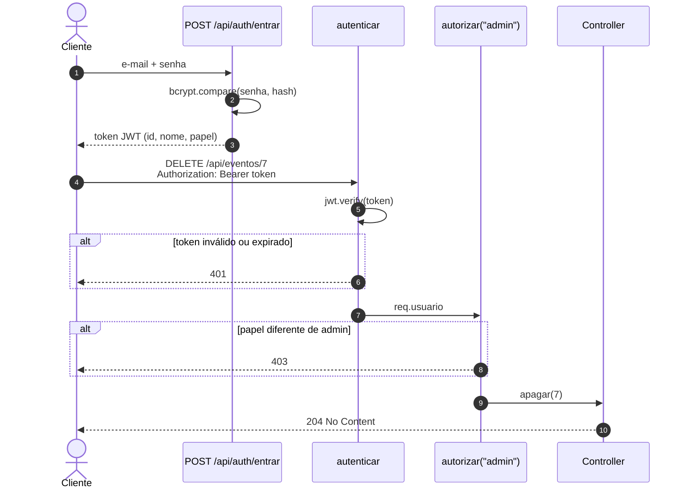

| Perfil | Ler catálogo | Criar | Editar | Apagar |
|---|:---:|:---:|:---:|:---:|
| Visitante (sem token) | ✅ | ❌ | ❌ | ❌ |
| `editor` | ✅ | ✅ | ✅ | ❌ |
| `admin` | ✅ | ✅ | ✅ | ✅ |

### 🧱 Camadas da API

Cada requisição percorre sempre as mesmas camadas, e cada uma tem uma única responsabilidade:

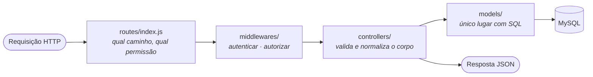

### 🗄️ Modelo de dados — MySQL (catálogo)

As tabelas são criadas automaticamente quando a API sobe (`database/criarTabelas.js`). Eventos podem estar ligados a um pesqueiro; se o pesqueiro for apagado, o evento continua existindo, apenas sem o vínculo (`ON DELETE SET NULL`).

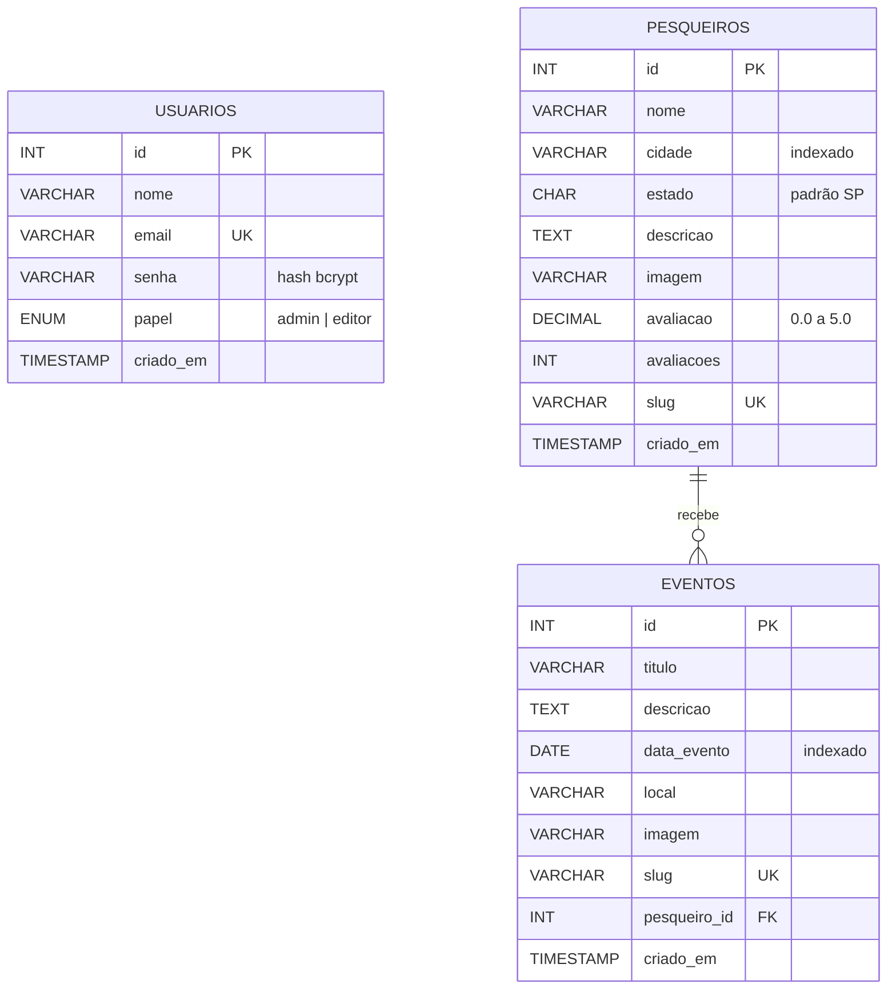

> Cada registro tem um **slug** (ex.: `torneio-de-tucunare-2025-05-10`), gerado a partir do título, sem acentos. Os endpoints de busca aceitam tanto o `id` numérico quanto o slug, o que deixa as URLs mais amigáveis para o SEO.

### 🔥 Modelo de dados — Firestore (parte social)

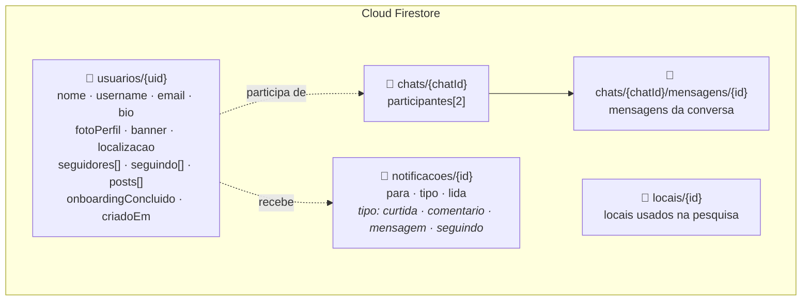

O chat e o contador de notificações usam `onSnapshot`, então novas mensagens e avisos aparecem na hora, sem recarregar a página.

### 🐳 Infraestrutura com Docker

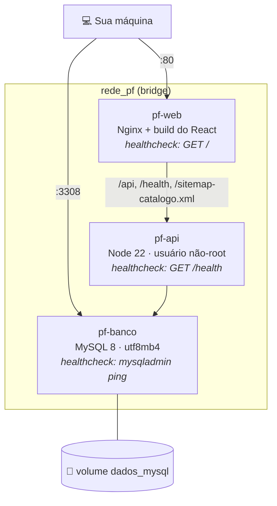

| Container | Imagem | O que faz | Sobe depois de |
|---|---|---|---|
| `pf-banco` | `mysql:8.0` | Guarda o catálogo e os usuários da API | — |
| `pf-api` | `node:22-alpine` | Executa a API Express | banco **saudável** |
| `pf-web` | `nginx:1.27-alpine` | Serve o React e faz proxy para a API | api |

O front é construído em **duas etapas** (multi-stage build): a primeira instala as dependências e gera o `build/` do React; a segunda copia só esse resultado para uma imagem enxuta do Nginx. Os dados do MySQL ficam no volume `dados_mysql` e sobrevivem a um `docker compose down`.

### 🌐 O papel do Nginx

| Caminho | Comportamento |
|---|---|
| `/` | `try_files` — qualquer rota do React cai no `index.html` |
| `/static/` | Cache de 1 ano (arquivos com hash no nome) |
| Imagens e fontes | Cache de 30 dias |
| `/index.html` | Sem cache, para que cada deploy chegue na hora |
| `/api/` | Proxy reverso para a API, com timeout de 30s |
| `/health` | Proxy para a verificação de saúde da API |
| `/sitemap-catalogo.xml` | Proxy para o sitemap gerado pela API |
| Arquivos ocultos (`/.env`, `/.git`) | Bloqueados |

Também ativa compressão **gzip**, esconde a versão do servidor (`server_tokens off`) e envia cabeçalhos de segurança (`X-Content-Type-Options`, `X-Frame-Options`, `Referrer-Policy`).

### ☁️ Ambientes

| Ambiente | Front | Catálogo | Dados sociais |
|---|---|---|---|
| **Produção** ([pesqueefaledb.web.app](https://pesqueefaledb.web.app/)) | Firebase Hosting | Conteúdo de reserva | Firebase |
| **Docker** (`http://localhost`) | Nginx | API + MySQL | Firebase |
| **Desenvolvimento** (`http://localhost:3000`) | `npm start` | API local, se estiver rodando | Firebase |

> A API ainda não está publicada em produção. Por isso, no site no ar, a Home exibe o catálogo de reserva.

---

## 🖥️ Tecnologias

<table>
  <tr>
    <th>Camada</th>
    <th>Tecnologia</th>
    <th>Para quê</th>
  </tr>
  <tr><td rowspan="4"><b>Front-end</b></td><td>React 19</td><td>Interface em componentes</td></tr>
  <tr><td>React Router 7</td><td>Rotas públicas e protegidas</td></tr>
  <tr><td>JavaScript · HTML5 · CSS3</td><td>Lógica e estilos (com modo escuro)</td></tr>
  <tr><td>Firebase JS SDK 12</td><td>Auth e Firestore no navegador</td></tr>
  <tr><td rowspan="5"><b>Back-end</b></td><td>Node.js 22 + Express 5</td><td>Servidor da API</td></tr>
  <tr><td>MySQL 8 + mysql2</td><td>Banco relacional do catálogo, com pool de conexões</td></tr>
  <tr><td>bcryptjs</td><td>Hash das senhas</td></tr>
  <tr><td>jsonwebtoken</td><td>Tokens de acesso</td></tr>
  <tr><td>cors · dotenv</td><td>Origens permitidas e variáveis de ambiente</td></tr>
  <tr><td rowspan="3"><b>Infraestrutura</b></td><td>Docker + Docker Compose</td><td>Ambiente completo com um comando</td></tr>
  <tr><td>Nginx 1.27</td><td>Estáticos, proxy reverso, gzip e cache</td></tr>
  <tr><td>Firebase Hosting</td><td>Hospedagem em produção</td></tr>
  <tr><td><b>Métricas</b></td><td>Google Analytics 4</td><td>Acessos e eventos de uso</td></tr>
</table>

---

## 🧱 Estrutura de pastas

```
.
├── public/                       Arquivos servidos como estão
│   ├── index.html                Meta tags, Open Graph, JSON-LD e carregamento do GA4
│   ├── manifest.json             Configuração de PWA
│   ├── robots.txt                O que os buscadores podem indexar
│   └── sitemap.xml               Sitemap das páginas fixas
│
├── src/                          Front-end React
│   ├── pages/                    Uma pasta por tela
│   │   ├── Index/                Página de apresentação
│   │   ├── Login/                Login e cadastro
│   │   ├── Onboarding/           Primeiro acesso
│   │   ├── Home/                 Feed + catálogo
│   │   ├── Pesquisa/             Busca
│   │   ├── NovaPublicacao/       Criar post
│   │   ├── VisualizacaoPost/     Post com curtidas e comentários
│   │   ├── Perfil/               Perfil e edição de perfil
│   │   ├── chat/                 Conversas
│   │   ├── Notificacao/          Central de notificações
│   │   ├── Sobre/                Sobre nós
│   │   └── NaoEncontrada/        Página 404
│   ├── components/               Peças reutilizáveis
│   │   ├── sidebar/              Menu lateral (desktop)
│   │   ├── bottomNav/            Barra inferior (mobile)
│   │   ├── perfil/               Cabeçalho, abas, galeria e estatísticas
│   │   ├── NotifToast/           Aviso flutuante de notificação
│   │   ├── OnboardingTour/       Tour guiado
│   │   ├── confirmacao/          Diálogo de confirmação
│   │   ├── Seo/                  Title e meta tags por rota
│   │   └── Analytics/            page_view a cada troca de rota
│   ├── routes/                   Rotas e ProtectedRoute
│   ├── hooks/
│   │   ├── useCatalogo.js        Busca o catálogo na API, com reserva
│   │   └── useNotifCount.js      Contador de notificações em tempo real
│   ├── services/api.js           Todas as chamadas à API (timeout de 8s)
│   ├── data/catalogoReserva.js   Catálogo usado quando a API não responde
│   ├── utils/usernameUtils.js    Validação e sugestão de username
│   ├── auth.js                   Funções de login, cadastro e logout
│   ├── analytics.js              Camada sobre o Google Analytics
│   └── firebase.js               Config do Firebase (não versionado)
│
├── server/                       API Node/Express + MySQL
│   ├── Dockerfile
│   └── src/
│       ├── server.js             Inicialização, CORS, /health e erros
│       ├── routes/index.js       Caminhos e permissões
│       ├── controllers/          Validam a requisição e montam a resposta
│       ├── models/               Acesso ao banco — único lugar com SQL
│       ├── middlewares/          autenticar (JWT) e autorizar (perfil)
│       ├── database/             Conexão, criação de tabelas e seed
│       └── utils/texto.js        Slug, validação de id e limpeza de texto
│
├── nginx/nginx.conf              try_files, gzip, cache e proxy
├── Dockerfile                    Front em duas etapas (build → Nginx)
├── docker-compose.yml            MySQL + API + Nginx
└── firebase.json                 Configuração do Firebase Hosting
```

---

## 🚀 Como rodar o projeto

### ✅ Pré-requisitos

| Ferramenta | Versão | Necessária para |
|---|---|---|
| [Node.js](https://nodejs.org/) | 22 ou superior | Todas as opções |
| [Docker Desktop](https://www.docker.com/products/docker-desktop/) | Recente | Opção 2 |
| [MySQL](https://dev.mysql.com/downloads/) | 8 | Opção 3 |
| Projeto no [Firebase](https://console.firebase.google.com/) | — | Todas as opções |

### 🔑 Passo obrigatório: o `src/firebase.js`

Esse arquivo está no `.gitignore` e não vem no repositório. **Sem ele o projeto não compila.**

```bash
cp src/firebase.js.example src/firebase.js
```

Preencha com os dados do seu projeto em **console.firebase.google.com → Configurações do projeto → Seus aplicativos**.

---

### Opção 1 — 🎨 Só o front-end

Suficiente para mexer nas telas. A Home mostra o catálogo de reserva enquanto a API não estiver no ar.

```bash
npm install
cp .env.example .env
npm start
```

Acesse **http://localhost:3000**

---

### Opção 2 — 🐳 Tudo em containers (recomendado)

Sobe MySQL, API e Nginx de uma vez. Requer o Docker Desktop aberto.

```bash
# 1. Variáveis de ambiente
cp .env.docker.example .env

# 2. Gere o JWT_SEGREDO e cole no .env
node -e "console.log(require('crypto').randomBytes(48).toString('hex'))"

# 3. Suba tudo
docker compose up -d --build

# 4. Carga inicial do banco, uma única vez
docker compose exec api npm run seed
```

Acesse **http://localhost**

No `.env`, é obrigatório preencher `DB_ROOT_PASSWORD`, `JWT_SEGREDO` e `CODIGO_ADMIN`. Sem o `JWT_SEGREDO`, o compose se recusa a subir.

**Comandos do dia a dia:**

```bash
docker compose ps          # estado dos containers
docker compose logs -f     # acompanhar os registros
docker compose logs api    # registros só da API
docker compose down        # derrubar (os dados do banco são preservados)
docker compose up -d       # subir de novo, em segundos
```

Portas usadas: **80** para o site e **3308** para o banco. Se alguma estiver ocupada, troque `PORTA_WEB` ou `PORTA_BANCO` no `.env`.

---

### Opção 3 — 💻 Front e API no VS Code, com MySQL local

```bash
# 1. Crie o banco no MySQL
#    CREATE DATABASE pesque_fale
#      CHARACTER SET utf8mb4 COLLATE utf8mb4_unicode_ci;

# 2. Configure a API
cd server
npm install
cp .env.example .env        # preencha DB_PASSWORD e JWT_SEGREDO
npm run seed

# 3. Suba a API
npm run dev                 # http://localhost:3001

# 4. Em outro terminal, o front
cd ..
npm start                   # http://localhost:3000
```

---

### 🔧 Variáveis de ambiente

<details>
<summary><b>Front-end</b> — <code>.env</code> na raiz (opções 1 e 3)</summary>

| Variável | Exemplo | Descrição |
|---|---|---|
| `REACT_APP_API_URL` | `http://localhost:3001` | Endereço base da API |
| `REACT_APP_URL_SITE` | `https://pesqueefaledb.web.app` | URL usada nas tags canônicas e no Open Graph |
| `REACT_APP_GA_ID` | `G-XXXXXXXXXX` | ID do Google Analytics 4 (vazio = desativado) |

</details>

<details>
<summary><b>API</b> — <code>server/.env</code> (opção 3)</summary>

| Variável | Exemplo | Descrição |
|---|---|---|
| `DB_HOST` | `localhost` | Endereço do MySQL |
| `DB_PORT` | `3306` | Porta do MySQL |
| `DB_USER` | `root` | Usuário do banco |
| `DB_PASSWORD` | — | Senha do banco |
| `DB_NAME` | `pesque_fale` | Nome do banco |
| `PORT` | `3001` | Porta da API |
| `URL_SITE` | `https://pesqueefaledb.web.app` | Base das URLs do sitemap |
| `ORIGENS_PERMITIDAS` | `http://localhost:3000` | Origens aceitas pelo CORS, separadas por vírgula |
| `JWT_SEGREDO` | — | Chave que assina os tokens (gere uma aleatória) |
| `CODIGO_ADMIN` | — | Código exigido para cadastrar um administrador |

</details>

<details>
<summary><b>Docker</b> — <code>.env</code> na raiz (opção 2)</summary>

| Variável | Padrão | Descrição |
|---|---|---|
| `DB_ROOT_PASSWORD` | — | Senha do root do MySQL (usada também pela API) |
| `DB_NAME` | `pesque_fale` | Nome do banco |
| `JWT_SEGREDO` | **obrigatório** | Chave dos tokens |
| `CODIGO_ADMIN` | — | Código de cadastro de administrador |
| `URL_SITE` | `http://localhost` | URL pública do site |
| `ORIGENS_PERMITIDAS` | `http://localhost,http://localhost:3000` | Origens aceitas pelo CORS |
| `PORTA_WEB` | `80` | Porta do site na sua máquina |
| `PORTA_BANCO` | `3308` | Porta do MySQL na sua máquina |
| `REACT_APP_GA_ID` | — | ID do Google Analytics 4 |

</details>

---

## 🔌 API REST

Com o Docker, tudo passa pelo Nginx em **http://localhost**. Rodando a API direto no VS Code, a base é **http://localhost:3001**.

### 📋 Endpoints

| Método | Caminho | Acesso | Descrição |
|---|---|---|---|
| `GET` | `/health` | 🟢 aberto | Saúde da API e do banco |
| `POST` | `/api/auth/registrar` | 🟢 aberto | Cria uma conta e devolve o token |
| `POST` | `/api/auth/entrar` | 🟢 aberto | Login, devolve o token |
| `GET` | `/api/auth/eu` | 🟡 token | Dados de quem está logado |
| `GET` | `/api/eventos` | 🟢 aberto | Lista eventos (`?futuros=1` mostra só os próximos) |
| `GET` | `/api/eventos/:id` | 🟢 aberto | Busca por id **ou** slug |
| `POST` | `/api/eventos` | 🟡 token | Cria evento |
| `PUT` | `/api/eventos/:id` | 🟡 token | Atualiza evento |
| `DELETE` | `/api/eventos/:id` | 🔴 admin | Apaga evento |
| `GET` | `/api/pesqueiros` | 🟢 aberto | Lista pesqueiros, do melhor avaliado para o pior |
| `GET` | `/api/pesqueiros/:id` | 🟢 aberto | Busca por id **ou** slug |
| `POST` | `/api/pesqueiros` | 🟡 token | Cria pesqueiro |
| `PUT` | `/api/pesqueiros/:id` | 🟡 token | Atualiza pesqueiro |
| `DELETE` | `/api/pesqueiros/:id` | 🔴 admin | Apaga pesqueiro |
| `GET` | `/sitemap-catalogo.xml` | 🟢 aberto | Sitemap gerado a partir do banco |

A leitura é aberta porque o catálogo é conteúdo público. A escrita exige o cabeçalho `Authorization: Bearer <token>`.

### 📦 Formato dos dados

<details>
<summary><b>Evento</b></summary>

```json
{
  "titulo": "Torneio de Verão",
  "data_evento": "2027-01-15",
  "local": "Lago Azul",
  "descricao": "Competição aberta a todas as idades.",
  "imagem": "evento1.jpg",
  "pesqueiro_id": 1
}
```

Obrigatórios: `titulo`, `local` e `data_evento` (formato `AAAA-MM-DD`).

</details>

<details>
<summary><b>Pesqueiro</b></summary>

```json
{
  "nome": "Lago Azul",
  "cidade": "Matão",
  "estado": "SP",
  "descricao": "Represa com quiosques e área de camping.",
  "imagem": "pesqueiro_311.jpg",
  "avaliacao": 4.8,
  "avaliacoes": 124
}
```

Obrigatórios: `nome` e `cidade`. A `avaliacao` deve estar entre 0 e 5.

</details>

<details>
<summary><b>Respostas de erro</b></summary>

Todos os erros seguem o mesmo formato:

```json
{ "erro": "Informe a data no formato AAAA-MM-DD." }
```

| Status | Quando acontece |
|---|---|
| `400` | Dados faltando ou inválidos |
| `401` | Token ausente, inválido ou expirado |
| `403` | Perfil sem permissão |
| `404` | Registro ou rota não encontrada |
| `409` | Registro duplicado (mesmo slug) |
| `500` | Erro interno |
| `503` | Banco fora do ar (no `/health`) |

</details>

### 👤 Conta de demonstração

Criada pelo `npm run seed`:

| E-mail | Senha | Perfil |
|---|---|---|
| `admin@pesquefale.local` | `admin123456` | admin |

> ⚠️ Senha simples de propósito: é uma conta de teste e não deve existir fora do ambiente de desenvolvimento.

### 🧪 Testando pelo terminal

No PowerShell, use `curl.exe` — o `curl` sem extensão é um apelido do `Invoke-WebRequest` e se comporta de outro jeito.

```bash
curl.exe http://localhost/health
curl.exe http://localhost/api/eventos
curl.exe http://localhost/api/pesqueiros
```

Login, para receber o token:

```bash
curl.exe -X POST http://localhost/api/auth/entrar -H "Content-Type: application/json" -d "{\"email\":\"admin@pesquefale.local\",\"senha\":\"admin123456\"}"
```

Criar um evento com o token recebido:

```bash
curl.exe -X POST http://localhost/api/eventos -H "Content-Type: application/json" -H "Authorization: Bearer SEU_TOKEN" -d "{\"titulo\":\"Torneio de Verao\",\"data_evento\":\"2027-01-15\",\"local\":\"Lago Azul\"}"
```

Exemplo de resposta do `/health`:

```json
{
  "status": "ok",
  "banco": "conectado",
  "tempo_resposta_ms": 3,
  "memoria_mb": 14,
  "tempo_no_ar_s": 128
}
```

### 🐬 Olhando o banco

Pelo **MySQL Workbench**: host `localhost`, porta **3308**, usuário `root`, com a senha definida em `DB_ROOT_PASSWORD`.

Ou direto pelo container:

```bash
docker compose exec banco mysql -u root -p pesque_fale
```

---

## 🔎 SEO e Analytics

### SEO

| Recurso | Onde está | O que faz |
|---|---|---|
| Meta tags base | `public/index.html` | Título, descrição, idioma e cor do tema |
| Open Graph e Twitter Card | `public/index.html` | Prévia bonita ao compartilhar o link |
| JSON-LD (`WebSite` + `SearchAction`) | `public/index.html` | Ajuda o Google a entender o site e a busca interna |
| Meta tags por rota | `components/Seo/Seo.jsx` | Título, descrição, canônica e `robots` diferentes em cada tela |
| `robots.txt` | `public/robots.txt` | Bloqueia páginas privadas (perfil, chat, notificações…) |
| Sitemap fixo | `public/sitemap.xml` | Páginas que não mudam |
| Sitemap dinâmico | `GET /sitemap-catalogo.xml` | Gerado a partir dos eventos e pesqueiros do banco |

### Google Analytics 4

O GA4 só é carregado em **produção** e quando `REACT_APP_GA_ID` está preenchido. Em desenvolvimento, os eventos aparecem apenas no console (`console.debug`), o que facilita testar sem poluir as métricas.

O componente `RastreioDeRotas` envia um `page_view` a cada troca de rota e **anonimiza** os caminhos (`/perfil/abc123` vira `/perfil/:id`), para que nenhum identificador de usuário chegue ao Analytics.

| Evento | Quando é disparado |
|---|---|
| `page_view` | A cada troca de rota |
| `login` | Login bem-sucedido |
| `login_falhou` | Tentativa de login com erro |
| `sign_up` | Novo cadastro |
| `onboarding_concluido` | Fim do primeiro acesso |
| `publicacao_criada` | Novo post |
| `search` | Pesquisa realizada |
| `local_aberto` | Pesqueiro aberto pelo usuário |
| `selecionar_aba_feed` | Troca de aba no feed |
| `pagina_nao_encontrada` | Acesso a uma rota inexistente |

---

## 🎨 Design

| | Elemento | Valor |
|---|---|---|
| 🔵 | Cor principal | Azul escuro `#062A6C` |
| ⚪ | Contraste e legibilidade | Branco `#FFFFFF` |
| ⚫ | Cor secundária | Preto `#000000` |
| ✍️ | Tipografia | Open Sans, Anton, Anton Didone |
| 🌊 | Identidade | Inspirada no universo da pesca |
| 🎯 | Princípios | Simplicidade, usabilidade e interface limpa |

---

## 👥 Equipe

<table>
  <tr>
    <td align="center" width="16%">
      <br />
      <b>Henrique</b><br />
      <sub>Back-End · Front-End · Testes</sub>
    </td>
    <td align="center" width="16%">
      <br />
      <b>Danilo</b><br />
      <sub>Front-End</sub>
    </td>
    <td align="center" width="16%">
      <br />
      <b>João Pedro</b><br />
      <sub>Documentação</sub>
    </td>
    <td align="center" width="16%">
      <br />
      <b>Lucas</b><br />
      <sub>Documentação</sub>
    </td>
    <td align="center" width="16%">
      <br />
      <b>Vinicius</b><br />
      <sub>Documentação</sub>
    </td>
    <td align="center" width="16%">
      <br />
      <b>Rebeca</b><br />
      <sub>Documentação</sub>
    </td>
  </tr>
</table>

| Integrante | Responsabilidades |
|---|---|
| **Henrique** | Back-End (API, banco de dados, autenticação, Docker e Nginx), Front-End e Testes |
| **Danilo** | Front-End |
| **João Pedro** | Documentação |
| **Lucas** | Documentação |
| **Vinicius** | Documentação |
| **Rebeca** | Documentação |

---

## 🚧 Status e próximos passos

### ✅ Concluído

- [x] Levantamento de requisitos funcionais e não funcionais
- [x] Identidade visual definida (paleta, tipografia e logotipo)
- [x] Front-end estruturado em React
- [x] Sistema de autenticação funcional (Firebase)
- [x] Telas principais implementadas
- [x] Deploy em produção ([pesqueefaledb.web.app](https://pesqueefaledb.web.app/))
- [x] API REST própria (Node/Express + MySQL)
- [x] Autenticação da API com JWT e permissão por perfil
- [x] Containerização com Docker e Docker Compose
- [x] Nginx como proxy reverso, com cache e compressão
- [x] SEO e Google Analytics 4

### 🔜 Próximos passos

- [ ] Páginas públicas de evento e pesqueiro (`/evento/:slug` e `/pesqueiro/:slug`)
- [ ] Publicar a API em produção
- [ ] Recomendações baseadas em localização (RF 03)
- [ ] Migração do Create React App para o Vite

---

## 📄 Licença

📘 Projeto acadêmico — uso educacional.

<div align="center">

Feito com 🎣 pela equipe **Pesque & Fale**

</div>
